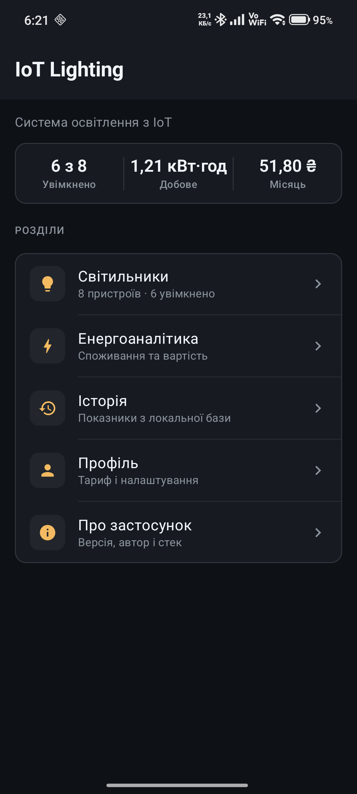
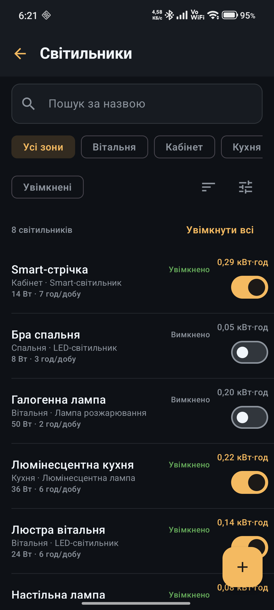
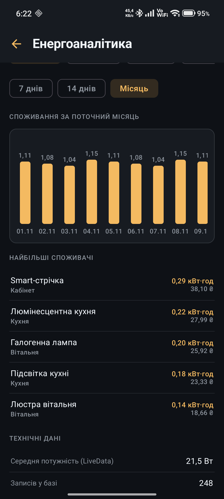
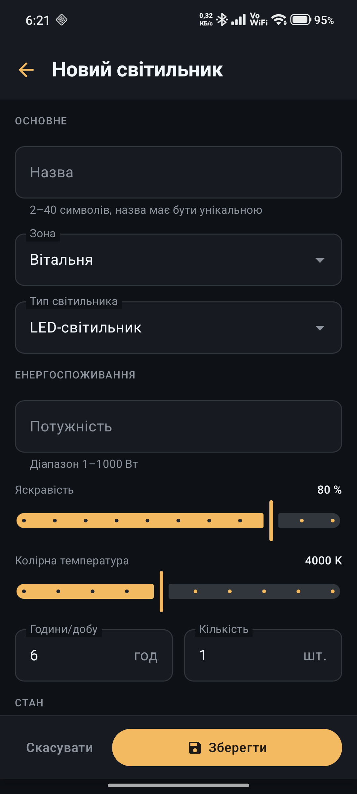
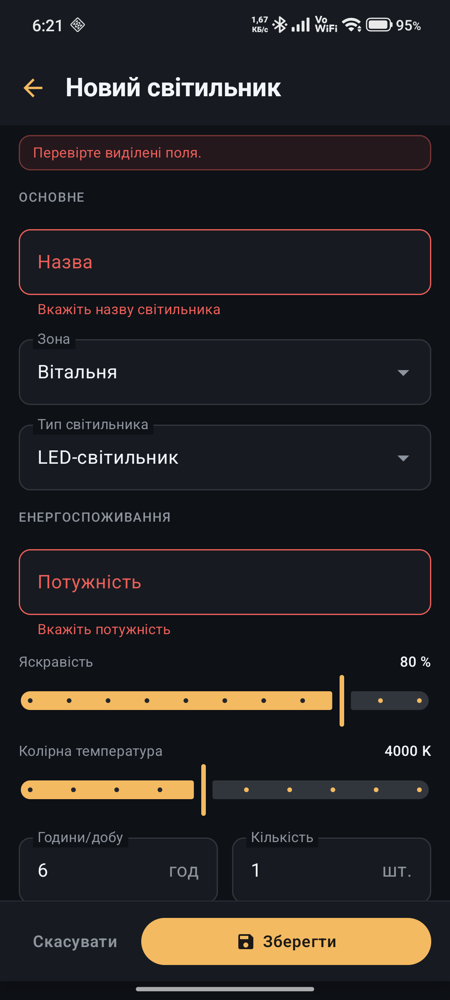
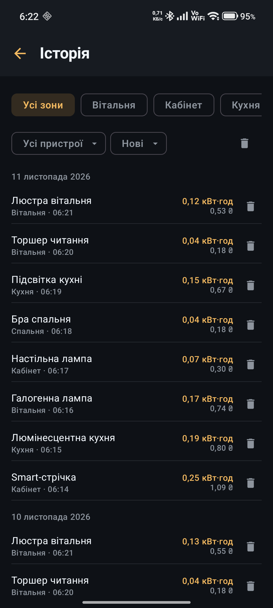

<div align="center">
  
# КП2 (Варіант 13): Система освітлення з IoT

[](https://vshymanskyy.github.io/StandWithUkraine/)

</div>

Android-застосунок для керування освітленням квартири: світильники за зонами, живлення, форми з перевіркою полів, енергоаналітика й історія показників у локальній базі.

Практична робота №2 (заняття 5–8) з курсу «Розробка програмного забезпечення мобільних пристроїв». КПІ ім. Ігоря Сікорського, варіант 13: «Система освітлення з IoT».

## Можливості

- Головне меню зі зведенням: скільки світильників увімкнено, добове споживання, фактична сума за поточний місяць.
- Список світильників: пошук за назвою, фільтри за зоною і типом, показ лише увімкнених, сортування, перемикач живлення в рядку.
- Створення, редагування й видалення світильника з підтвердженням. Валідація назви, унікальності, потужності, яскравості, кольорової температури та годин роботи.
- Масова дія «Увімкнути всі / Вимкнути всі», доступна лише без активних фільтрів.
- Енергоаналітика: графіки за 7 днів, 14 днів і поточний календарний місяць, найбільші споживачі, середня потужність, кількість записів.
- Історія показників із Room: фільтри за зоною і пристроєм, сортування за часом, енергією та вартістю, видалення окремих записів або всієї історії.
- Профіль: ім'я, пошта, тариф, зміна пароля. Демонстраційний режим збою збереження.

## Скріншоти

| Головне меню | Список світильників | Енергоаналітика |
|:---:|:---:|:---:|
|  |  |  |

| Форма | Валідація | Історія |
|:---:|:---:|:---:|
|  |  |  |

Решта знімків лежить у [`docs/screenshots`](docs/screenshots).

## Технології

| Шар | Рішення |
|---|---|
| Мова | Kotlin 2.2.10 |
| UI | Jetpack Compose, Material 3, власна темна тема |
| Навігація | Navigation Compose 2.10.2 |
| Стан | ViewModel 2.11.0, StateFlow, LiveData, SavedStateHandle |
| Дані | Room 2.8.5, KSP 2.2.10-2.0.2, експорт схем у JSON |
| Асинхронність | Kotlin Coroutines 1.10.2 |
| Збірка | AGP 9.4.1, Gradle 9.6.0, minSdk 30, compileSdk 37, targetSdk 37 |
| Тести | JUnit4, kotlinx-coroutines-test, Room in-memory |

Архітектура: MVVM + Repository. Одна Activity, ручний `AppContainer` без Hilt, `MockEnergyRemoteDataSource` із затримкою 900 мс замість мережі.

## Структура

```
app/src/main/java/ua/kpi/iot_lighting/prac2/
├── data/          Room (entities, DAO, міграція), репозиторії, налаштування, mock-джерело
├── di/            AppContainer
├── domain/        моделі, калькулятор, валідатори, інтерфейси репозиторіїв
├── navigation/    маршрути й NavHost
└── ui/            екрани, компоненти, тема, ViewModel-і
```

Схеми Room обох версій зберігаються в `app/schemas`, тому міграцію `v1 → v2` (`isOnline` → `isPoweredOn`) можна перевірити окремо.

## Збірка

Потрібен Android SDK 37 і JDK 25. Gradle підтягне потрібний JDK через foojay, якщо його немає локально.

```bash
./gradlew assembleDebug
```

APK з'явиться в `app/build/outputs/apk/debug/app-debug.apk`.

## Тести

```bash
./gradlew testDebugUnitTest          # 26 модульних тестів
./gradlew connectedDebugAndroidTest  # 6 тестів Room на пристрої або емуляторі
```

Модульні тести покривають валідацію форми (12), налаштування (8) і калькулятор енергії (6). Інструментальні перевіряють JOIN, фільтри, каскадне видалення, агрегати, перемикання живлення та видалення діапазону показників.

## Обмеження

- Пароль демонстраційного профілю зберігається в `SharedPreferences` відкритим текстом.
- Показники надходять із фейкового джерела, а не з реального IoT-пристрою.
- Застосунок має лише українську локалізацію.

## Автор

Недяк Олександр Сергійович, група ТВ-32, КПІ ім. Ігоря Сікорського, 2026.
